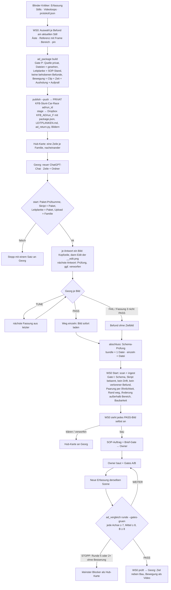

# AD-Workflow R1 · Kritiker-Erfassung → Zielbild im Webchat → Bau → Blind-Vergleich (23.11.2026)

**Kurz:** Der blinde Kritiker erfasst die ganze Schleife (Stills, Videoloops, Protokoll). WS0 baut daraus ein privates Paket auf GitHub und legt je Szenenfamilie einen Ordner in Georgs Dropbox (`KFB_AD`). Georg öffnet einen ChatGPT-Chat, fügt eine Zeile ein und zieht den Ordner hinein. Der Skill malt die Befunde in die echten Screenshots, Georg sagt je Bild PASS/TUNE/FAIL und lädt die freigegebenen Bilder bzw. die eine Rückgabedatei herunter. WS0 holt sie beim nächsten Sitzungsstart ab, prüft, schreibt SOP-Aufträge und lässt den Bau blind gegen das Zielbild prüfen, bevor Georg etwas sieht.
**Gilt neben:** `KFB_SOP_R1.md` (Stamm R2, Schritt 2c), `KFB_SOP_AESTE_R1.md`, `KFB_REFERENZEN_R1.md`, `tools/qa_matrix.r1.json`, `tools/CRITIC_BLIND_PROMPT.md`. Ersetzt den Ablauf-Teil von `replies/AQUA_10/WEBCHAT_ZIELBILDER_R1.md` (Abweichungen §10).
**Status:** R1, Probelauf `test_r1/` grün (simuliert, ohne Bildgenerierung), drei Review-Runden (`REVIEW_LOG.md`, Runde-3-Befunde eingearbeitet, keine vierte Runde). Nichts gepusht. **Vor dem ersten echten Lauf:** §11.1 (öffentlicher Spiegel; `build` verweigert bis dahin öffentliche Quellen), Skill-Upload bei Georg, Formattest im ersten Chat (§11.5).

## 1 · Rollen
| Rolle | Tut | Tut nie |
|---|---|---|
| Blinder Kritiker | Erfasst die Schleife nach Protokoll, bewertet nach Matrix A–H | kennt keine Owner-Notizen |
| WS0 (Skill `kfb-ad-package`) | Auswahl je Befund am aktuellen Still und festnageln, Paket bauen/veröffentlichen, Rückgaben abholen, selbst prüfen, Aufträge, Blind-Vergleich, Register | Zwischenstände an Georg; Zielbilder umdeuten |
| Webchat (Skill `kfb-art-direction`) | Malt nur Paket-Befunde auf die hochgeladenen Screenshots, beschriftet jedes Bild, prüft es, holt Georgs Urteil, schreibt die Rückgabe | Befunde erfinden, Figuren/Text/Kamera ändern, Varianten-Reihen |
| Georg | Zeile + Ordner je Familie, PASS/TUNE/FAIL je Bild, Download-Klicks, Endabnahme | Kopieren, Umbenennen, Terminal, Boten-Meldungen |
| Owner (Aqua-Chat, WSB …) | Baut nach Auftrag, eigene Gates, stille Schleife | baut ohne freigegebenes Zielbild |
| Vergleichs-Kritiker (frisch je Runde) | Bau ↔ Zielbild nach Matrix, B Ziel-Treue | sieht Ausgangs-Still oder Verlauf |

## 2 · Ablauf, Gates, Stopp-Regeln

**Stopp-Regeln:** Paket mit Fehler geht nicht raus. Webchat: `start` bricht bei falscher Paket-Prüfsumme, fremdem Skript, veränderter Leitplanke oder unpassendem Upload ab; höchstens zwei Neuversuche je Bild, höchstens drei Fassungen je Rolle, dann FAIL; nicht malbare Befunde gehen mit `verwerfen` und Grund zurück. Stil driftet → Lauf abschließen, neuer Chat mit `Lauf 2` und Anker-Bild. Rückgabe mit Drift, unbekanntem Skript oder verlorenem Befund → abgelehnt, kein Flicken. Bau: `ad_vergleich.py` zählt Runden, PASS nur mit B ≥ 8 und bestätigten Gates, Stopp nach Runde 5 oder 2 Runden ohne Besserung.

## 3 · Ablage: privat und öffentlich
| Was | Wo | Warum |
|---|---|---|
| Stills, `__edit.png`, Clips, Frames, Zielbilder, Rückgabe-Manifest | **privat:** `georg-doc/KFB-Stunt-Car-Race`, Branch `ad/<run_id>`, Ordner `ad/<run_id>/paket/` und `ad/<run_id>/rueckgabe/<F>_l<n>/` | Spiel- und Produkt-Screenshots; kayfabizarro ist öffentlich (`tools/README_PRIVATE_ASSETS.md`) |
| Dieselben Medien lokal, Erfassungs-Kopie, neue Erfassungen der Vergleichsrunden | nur unter `_privat…/` in einem Unterordner von `replies/` (`replies/<PRODUKT>/ad_<run>/_privat/…`, `_privat_quelle/…`, `…/_privat/vergleich_<F>_r<n>/`) | `sync_github.sh` überspringt `*/_privat*`; `build` und `ad_vergleich` erzwingen das |
| AD-Bilder für Georg (klären, verworfen, Endabnahme) | per SendUserFile direkt an Georg, Hub-Karte nur mit Text und privatem GitHub-Link | Hub-Bilder unter `replies/` würden gespiegelt |
| Georgs Upload-Ordner, Paket-Register, Eingang | `~/Dropbox/CLAUDE/KFB_AD/` | außerhalb von KFB_HUB, nie gespiegelt |
| Workflow, Schemas, Skill-Texte, Auswahl, Briefs, Berichte (nur Text, ohne absolute Pfade) | `replies/AD_WORKFLOW_R1/`, `replies/<PRODUKT>/ad_<run>/` → öffentlicher Spiegel | keine Medien, keine Schlüssel |

Publizieren nur mit `ad_package.py publish`: Commit nur unter `ad/<run_id>/…`, `diff-tree`-Prüfung, vorhandene Rückgabe-Ordner werden nie überschrieben, ohne `--push` reine Probe.

## 4 · Benennung, Versionen, Drift-Schutz
- `run_id` `<produkt>-ad-r<n>` = Branch-Suffix; neue Erfassung = neue `run_id`. `paket_rev` r1, r2 …: jede Änderung = neue Revision in neuem Ordner und im Repo unter `ad/<run_id>/paket_<rev>/`; `pakete.json` führt jede Revision, der Ingest wählt sie nach der Rückgabe.
- Georgs Ordner `<run_id>_<rev>_<F>_l<lauf>`; die Aufrufzeile nennt ihn (`… Familie D Lauf 1 Ordner aqua10-ad-r1_r1_D_l1 #…`).
- **Auswahl festgenagelt:** `pin` schreibt die sha256 der von WS0 angesehenen Stills/Clips in die Auswahl; `build` lehnt jede andere Datei ab (die Aqua-Erfassung wurde am 23.11. während der Arbeit an Ort und Stelle neu geschrieben).
- **Paket-Prüfsumme** = sha256 der kanonischen `package.json`; die ersten 12 Zeichen stehen in der Aufrufzeile, `start` prüft sie, der Ingest vollständig.
- **Skript und Leitplanke reisen im Paket:** `ad_return.py` und `LEITPLANKEN.md` liegen in jedem Upload-Ordner, ihre Prüfsummen stehen in `package.json`; `start` läuft nur mit genau diesen. Der Ingest kennt nur Skript-Prüfsummen aus `tools/skill_versions.json`. Zählt die SOP hoch, verweigert `build`, bis die Leitplanke nachgezogen ist (Kopfzeile mit Versionen), und `test_ad.py` schlägt fehl. Georg muss dafür nichts neu hochladen.
- Szene `S<nr>_<name>`, Befund `F01…` mit Quelle (`ZUSAMMEN_R2.md #14`, Kritiker-Belege). Medien sprechend: `media/stills/S16_hai_angriff__trouble_desktop__aufprall.png`, `media/edit/…__edit.png`, `media/clips/S16_hai_angriff__trouble_desktop.mp4`.
- Zielbild `F03_aufprall_v2`; im Chat steht vor jedem Bild die Kopfzeile `Nächstes Bild: F03 · Aufprall · Fassung 2` (das Bildwerkzeug beendet die Antwort, Prüfung folgt in der nächsten).
- Ablauf-Stand: SKILL.md-Kopf „Ablauf r1“ = `package.json › ablauf`; weicht er ab, stoppt der Chat mit „Skill veraltet“. Rückgabe `kfb-ad-return_<run_id>_<F>_l<lauf>_<Startzeit>.json`.

## 5 · Freigabe festhalten
Georg antwortet frei („F03 PASS, F04 TUNE Monitor ganz weg“). Der Skill speichert je Bild Status, Georgs Wortlaut, Zeit (UTC) und Fassung; nur die neueste Fassung kann freigegeben werden; nach jeder Freigabe steht eine `ZUSTAND`-Zeile im Chat (Grundlage der Wiederaufnahme, wenn die Sandbox verloren geht). Nur `PASS` wird gebaut. Übergeht Georg bewusst eine Leitplanke, steht in der Baubarkeit `false` + „Georg-Vorgabe“ (SOP §1); der Ingest macht daraus „klären“. Simulierte Rückgaben lehnt der Ingest ohne `--erlaube-simuliert` ab und stempelt Briefs „NICHT VERSENDEN“.

## 6 · Bildformat und Check-in
**Format:** Die Screenshots sind 16:9, Bildmodelle geben feste Formate aus (etwa 3:2, 1:1). Das Paket liefert je Still eine aufgefüllte Fassung `…__edit.png` (grauer Rand, Original unskaliert, 3:2). Der Webchat bearbeitet sie; der Ingest entfernt den Rand proportional und skaliert auf Originalgröße (Probelauf: aus 1536×1024 pixelgenau, Abweichung 0,1/255). Ist der Rand übermalt, wird „klären“ daraus. Ein drittes Format lehnt das Skript ab.

| Weg | Wie | Bewertung |
|---|---|---|
| a · GitHub schreibt | Webchat committet nach `ad/<run_id>/rueckgabe/…` | ChatGPT-GitHub-App ist offiziell Lesen/Suchen/Zitieren. Nur, wenn ein Schreib-Werkzeug für Binärdateien sichtbar ist und die Bilder als Datei vorliegen. Nicht verlangt. |
| b · Codex / Agent-Modus | Codex pusht; Agent-Modus lädt per Browser hoch | **Verworfen:** Codex sieht die im Chat erzeugten Bilder nicht; Agent-Modus bräuchte Georgs GitHub-Anmeldung. |
| c · bundle | Liegen erzeugte Bilder als Datei in der Sandbox: eine JSON-Datei mit Manifest und eingebetteten PASS-Bildern, ein Download-Klick. | Bester Fall; ob ChatGPT das tut, ist nicht dokumentiert. Der Skill prüft es beim ersten Bild. |
| **c2 · einzeln (erwarteter Standard)** | Sonst lädt Georg jedes Bild **bei seinem PASS** mit dem Download-Knopf (die Antwort nennt die Kopfzeile), am Ende die Rückgabedatei. Der Ingest nimmt je Ziel nur Bilder, die ab seiner PASS-Zeit geladen wurden, ignoriert Doppelte, ordnet über Ähnlichkeit zum Quell-Still zu und meldet „mehrdeutig“, sobald ein zweites Bild zum selben Still passt (z. B. eine ältere Fassung nach dem PASS geladen); dann prüft WS0 per Blick und setzt `--paar`. Die sha256 des zugeordneten Bilds kommt ins Manifest. | Je PASS-Bild ein Klick plus eine Datei, kein Kopieren, kein Umbenennen, Reihenfolge egal. |

Abholung: `ad_ingest.py scan` beim WS0-Sitzungsstart und nach `/compact` (Skill §0) findet neue Rückgaben in `~/Downloads` und `KFB_AD/eingang`; Georg meldet nichts.
**Ablauf im Chat:** je Antwort ein Bild; Georg antwortet nach jedem Bild mit PASS/TUNE/FAIL oder „weiter“ (steht einmal in der Hub-Karte).
**Einmal einrichten (Georg):** ChatGPT → Skills → Erstellen → Vom Computer hochladen → Ordner `chatgpt-skill/kfb-art-direction` (Dropbox `KFB_HUB/30_DECISIONS/replies/AD_WORKFLOW_R1/`). Skills gibt es in Business/Enterprise/Edu-Arbeitsbereichen. Ohne Skill-Funktion: ChatGPT-Projekt „KFB Art Direction“ mit `SKILL.md` als Anweisung; Skript und Leitplanke kommen ohnehin mit jedem Ordner. Eine GitHub-App ist nicht nötig.
**Einmal einrichten (WS0):** `claude-skill/kfb-ad-package` nach `~/.claude/skills/`; Zeile „AD: beim Start `ad_ingest.py scan`“ in `WS0_STATE.md`; §11.1 entscheiden lassen.

## 7 · Vom Zielbild zum Auftrag
`ad_ingest.py` schreibt je freigegebenem Befund `briefs/BRIEF_<run>_<F>.md` in SOP-Form: ABSICHT (Paket-Absicht + gelöstes Problem), GENRE, OWNER, ZIEL (privater Link je Zielbild mit Georgs Wortlaut und Zeit, Ausgangs-Still mit Ereignis und Clip-Zeit, Clip mit Fenster, Referenzen mit Wirksamkeit und Frame), FERTIG (Blind-Vergleich), GRENZEN („bleibt“ + Kanon), DETAIL (Änderung, Befund, Quelle, Build, SOP-Stand, Äste, Baubarkeit). Ergebnis je Befund: **bau** (versandbereit erst mit genau einem Owner, ohne neue Assets, nicht simuliert, Paarung eindeutig), **klaeren** (Hub-Karte), **kein_pass / kein_bild** (nichts bauen; vom Webchat verworfene Befunde als Hub-Karte). Vor dem Versand: `tools/brief_gate.py <brief> --domains …` (Vorschlag im Stub) und der Prüf-Agent.

## 8 · Blind-Vergleich Bau ↔ Zielbild
`vergleich/<F>.json`: ABSICHT, GENRE, Zielbilder (bei gesetztem Bereich das Kern-Komposit: Original außerhalb, Ziel innerhalb) + Zielkern, Erfassungs-Vorgabe (Szene, Lauf, Auflösung, Ereignis/Kamera, Bewegung als Video), Matrix und Prompt, Schwellen, `basis` relativ zum Hub. Nicht mitgegeben: Ausgangs-Still, Owner-Notizen, Webchat-Verlauf. `ad_vergleich.py runde … --erfassung <…/_privat/vergleich_<F>_r<n>> --gates-gruen` verweigert öffentliche Erfassungsordner, prüft die Kritiker-Ausgabe (A–H, höchstens 3 × n/a, B nie n/a, Belege für Zahlen > 6), zählt Runden und entscheidet PASS / WEITER / STOPP.

## 9 · Fehlerbilder
| Fehlerbild | Gegenmittel | Wo geprüft |
|---|---|---|
| Drift (Erfassung, Paket, Skript, SOP) | `pin` + `build`-Abgleich; kanonische Paket-Prüfsumme; Skript und Leitplanke im Paket mit Prüfsumme; `skill_versions.json`; Leitplanken-Kopf = SOP-Stand | `build`, `start`, `ad_ingest`, `test_ad.py` |
| Likeness ändert sich | Edit statt Neuerzeugung; Leitplanke §2/§5; Bereich + Messung außerhalb; Kern-Komposit; WS0-Blick | Skill, `ad_ingest`, WS0 |
| Unbaubares Übermalen | Leitplanke §3; Technik in einem Halbsatz; Feld `echtzeit_threejs` | Skill, `ad_ingest` → klären |
| Text hinzugefügt / verändert | Prompt-Regel, Selbstprüfung, Feld `kein_neuer_text`, Messung außerhalb des Bereichs; Anti-Sample 3 | Skill, `ad_ingest` |
| Stil-Drift zwischen Läufen | ein Chat = eine Familie; Anker = erstes PASS; `Lauf 2` mit Anker-Datei | Skill, WS0 |
| Verlorene Metadaten | sprechende Dateinamen; Ereignisse/Konfiguration aus `protokoll.json`; `quelle_still` je Ziel; fehlender Befund = Abbruch | `ad_package`, `ad_ingest` |
| Clip-Zeit fehlt in der Erfassung | Clip-Zeit aus `video_beginn_s`; sonst nur mit Ausnahme `zeit_unsicher`, Laufuhr-Ereignis bleibt | `ad_package validate` |
| Falscher Ordner hochgeladen | `start` prüft jede Datei der Familie per sha256 | `ad_return.py` |
| Bild sichtbar, aber nicht freigegeben, wird geladen | Kopfzeile je Bild, „verworfen – nicht laden“, Download erst beim PASS, nie neu erzeugen zum Zeigen | Skill |
| Sandbox verloren | `ZUSTAND`-Zeilen mit PASS-Zeit im Chat, `start --gestartet`, `ziel --ohne-datei --fassung`, `freigabe --zeit` | Skill |
| Falsche Fassung geladen (Weg einzeln) | Kandidaten erst ab PASS-Zeit; zweites passendes Bild = mehrdeutig; Regressionstest | `ad_ingest` |
| Neue Paket-Revision | Repo-Pfad `paket_<rev>`, Register je Revision | `ad_package`, `ad_ingest` |
| Lauf 2 von Hand gebaut | `stage --lauf 2 --anker … --nur …`, `start --nur` (übrige Befunde „anderer Lauf“) | `ad_package`, `ad_return.py` |
| Alter Skill bei Georg | Ablauf-Stand im Paket, Chat stoppt mit einem Satz | `start`, Skill |
| Befund nicht malbar | `verwerfen` mit Grund → Ingest `kein_bild` + Hub-Karte | `ad_return.py`, `ad_ingest` |
| Georg als Kopier-Station | Zeile + Ordner, Download-Klicks, Abholung beim Sitzungsstart, Zuordnung per Ähnlichkeit | Workflow §6 |
| Private Medien öffentlich | `build` verweigert öffentliche Quelle und Paketordner; `publish` nur unter `ad/<run_id>/`; Spiegel-Ausschluss §11.1 | `build`, `publish`, WS0 |
| Falsches Bildformat / übermalter Rand | aufgefüllte Fassung; Rückführung; Randprüfung; drittes Format = Ablehnung | `ad_return.py`, `ad_ingest` |
| Abgebrochener Download / Dubletten | Ingest meldet unlesbare Datei; Doppelte ignoriert; `scan` je run/Familie/Lauf; `abschluss` erzeugt dieselbe Datei erneut | `ad_ingest`, `ad_return.py` |
| Mehrere Owner im Befund | nicht versandbereit bis genau einer feststeht | `ad_ingest` |
| Bau ohne Rundenkontrolle | `ad_vergleich.py` mit Rundenzähler, Gates-Schalter, Stopp | WS0 |

## 10 · Abweichungen vom Entwurf `WEBCHAT_ZIELBILDER_R1.md`
1. **Kein Maßstab-Schritt im Chat.** Referenzen legt WS0 im Paket aus `KFB_REFERENZEN_R1.md` fest, mit Frame (SOP §2, keine Sicherungsschleifen).
2. **2×2 nur als Übersicht.** Gemalt wird jeder Screenshot einzeln; das Blatt setzt das Skript zusammen.
3. **Machbarkeit:** Prüfung im Chat vor Georgs Urteil, WS0-Prüfung danach; Konflikt → Hub-Karte.
4. **Ablage:** nicht `replies/AQUA_10/zielbilder_r1/` (öffentlich), sondern privat (§3).
5. **HUD-Kit-Blatt (`FEHLT_IM_KIT.md`)** ist kein Übermalen, sondern neue freigestellte Teile: nicht Teil von R1, später Typ `kit_teil`.

## 11 · Vorschläge an WS0 (nicht umgesetzt; SOP, Register und `sync_github.sh` unverändert)
1. **Vor dem ersten Lauf, Datenschutz:** Im öffentlichen Spiegel liegen bereits rund 169 Aqua-Erfassungs-PNGs (`replies/AQUA_CRITIC_R2/belege/**`, `replies/AQUA_10/erfassung_r1/**`); die Erfassung wird zudem an Ort und Stelle neu geschrieben und beim nächsten Sync wieder gespiegelt. Fertige Änderung: `VORSCHLAG_sync_github.diff`. Besser noch: Erfassungen künftig gleich unter `…/_privat/` schreiben lassen (Aqua-Chat). Ob vorhandene Dateien aus dem Branch entfernt werden, entscheidet Georg per Hub-Karte. Bis dahin verweigert `build` öffentliche Quellen.
2. **Erfassung (Aqua-Chat):** `protokoll.json` schreibt `beginn_s` immer 0 und keinen Video-Start. Bitte `video_beginn_s` je Szene; dann rechnet `ad_package` die Clip-Zeiten, die Ausnahme `zeit_unsicher` entfällt. `gangster_desktop` ist unvollständig, Handy-Läufe fehlen.
3. **SOP:** Stamm §2 Schritt 2c und §6 („Webchat … bedient von WS0“) um eine Zeile ergänzen: „Zielbilder über AD_WORKFLOW_R1 (Georg bedient den Chat mit einer Zeile, WS0 bereitet vor und holt ab)“. Danach Leitplanken-Kopf auf die neue Version ziehen (`test_ad.py` erinnert daran).
4. **Installation:** `tools/ad_*.py` nach Freigabe nach `30_DECISIONS/tools/` (Pfade in den Skills anpassen); Claude-Skill nach `~/.claude/skills/`; Scan-Zeile in `WS0_STATE.md`.
5. **Formattest im ersten echten Chat (Familie A):** (a) welches Format das Bildmodell zurückgibt und ob der graue Rand grau bleibt, (b) ob erzeugte Bilder als Datei in der Sandbox liegen, (c) ob Referenz-Frames in die Edits durchschlagen (dann Frames aus dem Upload nehmen, neue Paket-Revision), (d) ob die Antwort nach dem Bild endet (Ablauf ist darauf ausgelegt), (e) ob die Uploads in `/mnt/data` byte-gleich ankommen (`start` prüft sie; sonst Hinweis an WS0). Ergebnis als Zeile in `AD_WORKFLOW_R1.md` §6 und, falls nötig, `SKILL.md` mit „Ablauf r2“ (dann Georg neu hochladen lassen).
6. **Register:** eine V-Zeile „AD-Workflow R1“ (Rollen, private Ablage, Check-in einzeln/bundle, Schwellen B ≥ 8, Ausnahme `zeit_unsicher` für Aqua erfassung_r1).

## 12 · Test
Probelauf: `test_r1/LAUF.md` (`bash test_r1/lauf.sh`). Werkzeug-Tests: `python3 -W ignore tools/test_ad.py` (33 Tests).
