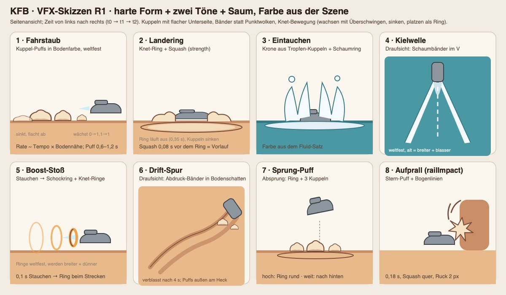

# VFX und SFX R1 · Prüfer D · 21.10.2026

Was macht Probe und Spiel lebendig? Nur gelesen, nichts geändert, kein Push.

**Prüfstand**
- Probe `gelaende-probe.html`, Port 8751
- Spiel `kfb-planet-t439` @ `eac5cb0`
- Audio-Zweige: ElevenLabs-SFX `f9d3ecb92`, Racer-Gears `ceec5af4d`, Flight-Crash `945518d38`, Ambience `0a9bfc90d`
- Effekt-Bildsprache R1 `6efe3839a`

**Belege**
- Bilder: `img/vfxsfx-*.png` mit Standardwerten und mit Georgs Werten (Sonne 12°, Erdung aus, Wasserstand 0,12).
- Skript: `node scripts/vfxsfx-shots.mjs img std|georg`.

## Zusammenfassung für Georg

1. Die Probe hat Speedlines, Düse, Schweben und Fluid-Blasen. Es fehlen Staub, Landering, Sprung-Puff, Boost-Stoß, Drift-Spur, Spritzer und Kielwelle. Die Bilder belegen jede dieser Lücken.
2. Im Spiel sind nur Motor und Saugen hörbar. Landung, Sprung, Drift, Aufprall und Wasser bleiben stumm, obwohl der Ereignisbus `M2EVENTS` die Ereignisse liefert. Die Probe hat gar keinen Ton.
3. Der Motor nutzt die propulsion-Loops. Das Schwebe-Summen P05 bricht dabei etwa alle 3,4 s ein. Die sauberen Drehzahl-Loops L1–L4 und die fertige Racer-Laufzeit liegen bereit.
4. Alle sieben fehlenden Effekte lassen sich aus drei Grundformen bauen: Kuppel-Puff, Ring und Band. Zusammen kosten sie etwa 4 Draw-Calls und weniger als 0,3 ms.
5. Empfehlung: ein Modul `kfb-vfx.v1` wie `kfb-light-pool.v1`, mit einer Quelle für Probe und Spiel. Es hängt am selben Ereignis-Strom wie der Ton (V-389). Mit der Top-10 unten wäre die erste Hälfte in 2–3 Tagen sichtbar und hörbar.

---

## 1 · Fehlende Effekte

Die Skizzen liegen in `img/vfxsfx-skizzen.jpg`.



**Drei Grundformen nach Bildsprache R1: harte Form, zwei Töne, Saum, Farbe aus der Szene.**
- **Kuppel-Puff (K):** instanzierte Halbkugel mit flacher Unterseite, rund 80 Dreiecke. Sie wächst auf das 1,1-Fache und federt auf 1 zurück, dann sinkt sie und flacht ab.
- **Ring (R):** flacher Ring auf dem Boden oder zur Kamera gedreht. Er wächst mit Ease-out und wird dabei dünner.
- **Band (B):** weltfestes Band wie die Speedlines der Probe (`gelaende-probe.html:2952-2985`), bei Bedarf auf Boden oder Wasser gelegt.

| # | Effekt | Auslöser | Form | Wirkung | Beleg (fehlt heute) | Kosten* | Aufwand |
|---|---|---|---|---|---|---|---|
| V1 | Fahrstaub | Tempo > 30 % und Bodennähe, Rate steigt mit dem Tempo | K, Pool 48, Bodenfarbe (`terrainDustColor`) | Der Wagen „berührt“ den Boden, Tempo wird lesbar | `vfxsfx-std-2-fahrt.png`, `…-georg-2-fahrt.png`: 59–95 km/h ohne Staub | 1 Draw, < 0,05 ms | S–M |
| V2 | Landering | k2t `landing.strength` > 0,15 (`k2t.js:178`) | R am Boden + 2–4 K, Squash als Vorlauf | Gewicht, Knete, Belohnung | `vfxsfx-std-6-landung.png` | 1 Draw, < 0,05 ms | S |
| V3 | Sprung-Puff | `takeoff` mit `jump` (`k2t.js:151`) | R + 3 K; beim Weitsprung wird der Ring nach hinten gezogen | Der Absprung wird spürbar; Hoch- und Weitsprung sehen verschieden aus | – | teilt sich die Pools mit V2 | S |
| V4 | Boost-Stoß | Boost-Flanke; der Ring kommt beim Strecken nach `surge` (+0,1 s) | 3 stehende R an der Düse, weltfest, Abstand 0,12 s | Der Boost „knallt“, wo heute nur der Kegel länger wird | `vfxsfx-std-3-boost-stoss.png` | 1 Draw, < 0,05 ms | S |
| V5 | Kielwelle | über Wasser, Tempo > 8 m/s | 2 B im V + Mittelband, Farbe aus dem Fluid-Satz | Wasser trägt den Wagen sichtbar | `vfxsfx-georg-7-wasser.png`: 96 km/h, gleitet wie auf Glas | 1 Draw, ~0,05 ms | M |
| V6 | Eintauch-Spritzer | Übergang Land → Wasser, Stärke = vy | Krone aus 6–10 gestreckten K + Schaum-R | Wasser wird zum Ereignis | – | teilt sich die Pools | M |
| V7 | Drift-Spur | Drift aktiv, Bodenkontakt | 2 B auf dem Boden (Höhe je Punkt, `polygonOffset`) + Seiten-K, Ton `uShade` | Drift hinterlässt etwas, das man zurückverfolgen kann | `vfxsfx-georg-4-drift.png` | 1 Draw, ~0,05 ms | M |
| V8 | Aufprall-Stern | `railImpact.strength` > 0,3 | Stern mit harter Kante + 2 Bogenlinien, 0,18 s | Comic-„Bonk“ | – | ~0 | S |

\* Die ms-Werte sind Schätzungen aus Dreiecks- und Füllmenge; es gibt keinen Vollbild-Pass und keine Partikelwolke. Prüfer C misst sie mit Ein/Aus-Paaren nach. Zum Vergleich: Die Probe lief headless bei meinen Fahrten mit 8–37 fps.

**Im Spiel umbauen:**
- Staub und Funken sind dort Punkt-Sprites (`src/modules/vehicleRig.js:100-103, 127-146`). Das ist das Partikel-Rauschen, das die Bildsprache ausschließt.
- Beides geht in V1 und V8 auf. Die Farbquelle `terrainDustColor` bleibt.

**Mit Georgs Werten:** Alle Farben kommen aus `uLit`, `uShade` und dem Boden. Bei 12° Sonne werden die Puffs dadurch warm und langschattig. Feste Farben wie `FLIGHT_VFX_THEME` (`kfb-flight-vfx.js:21-25`) passen bei diesem Licht nicht.

**`kfb-vfx.v1`: ja.** Drei Effekt-Orte laufen heute auseinander: Probe inline, `vehicleRig.js` und `kfb-flight-vfx.js`. Das Modul legt sie zusammen.
- Eine Quelle, byte-gleich in Probe und Spiel, nach dem Muster von `kfb-light-pool.v1` (Probe Z. 1676).
- `THREE` wird hereingereicht, weil die Probe r147 und das Spiel r186 nutzt.
- Aufruf:
  ```js
  createKfbVfx({ THREE, scene, palette:{ lit, shade, ground(x,z), fluid(kind) }, surfaceAt(x,z) }) → { emit(cue), update(dt,{camera,car,origin}), info(), dispose() }
  ```
- Die Cue-Namen sind dieselben wie bei k2t, `M2EVENTS` und Ton.
- `origin` gleicht aus, dass die Welt der Probe mit dem Wagen wandert.
- Pools sind fest, pro Bild wird nichts angelegt.

---

## 2 · Geräusche je Ereignis

**Anschluss**
- Ein `AudioContext` (`src/audio/engineAudio.js:12`) mit Bussen nach der Audio-Site: PLAYER_CRITICAL, WORLD_SFX, LOCAL_AMBIENCE, GLOBAL_BED.
- Ein kleiner World-Adapter, etwa 60 Zeilen:
  - Im Spiel abonniert er `M2EVENTS` (`M2Car.jsx:73-74, 373-374`).
  - In der Probe sammelt er `D.events` nach jedem `stepK2t`. `k2t.js:85` leert die Liste in jedem Teilschritt, und die Probe macht mehrere Teilschritte pro Bild (Z. 2947-2949).
  - Die Laufzeiten aus dem Repo hängen daran: `createRacer` (`dist/racer/engine.mjs` @ceec5af4d/945518d38), `createAmbience` (`kfb-ambience.v1.mjs` @0a9bfc90d) und `createCombat`.

| Ereignis | Auslöser | Datei(en) im Repo | Anschluss | Cartoon-Timing (Vorlauf · Treffer · Nachhall) | Bus · Pegel |
|---|---|---|---|---|---|
| Motor über Tempo | Drehzahl, Gas, Tempo | racer `L1_idle`…`L4_high`, `L5_overrun` | `racer.setTelemetry({speedKmh, throttle, brake, mode:'drive'})` + `tick()` | Lautstärke folgt dem Gas nach 0,12 s | PLAYER_CRITICAL · −20 LUFS bei halber Last |
| Schweben | immer; Pegel steigt, je kleiner das Tempo | `F2_jet_antigrav_loop` (oder P05 in der 3,35-s-Fassung) | Loop, Gain = 1 − Tempo | – | PLAYER_CRITICAL · −26 |
| Schalten / Fehlzündung | `vehicleRig` `shift`/`backfire` | `O1_upshift`, `O4_downshift_blip`, `O2c_backfire_double`, `crackle-1…4` | in der Racer-Laufzeit eingebaut | Unterbrechung 80–110 ms · Knall · 200 ms | PLAYER_CRITICAL |
| Boost | ⇧-Flanke | `P04_boost_ignite` + Schweif `O5_boost` | `racer.emit({type:'boost'})` | 80–100 ms Einsaugen während des Stauchens · Zündung bei +0,1 s (`surge`) · 0,5 s Schweif, Motor −4 dB | PLAYER_CRITICAL · −16 |
| Sprung hoch | `takeoff` + `jump` | Synthese „Boing“: Sinus 180 → 520 Hz, 220 ms | `sfx.play('jumpUp',{strength})` | 60 ms Federspannen · Absprung · Boing, Tonhöhe ~ vy | PLAYER_CRITICAL · −16 |
| Weitsprung | `takeoff` + `jump`, Tempo ≥ `longFrom` | `F4_takeoff` (0,6 s) + Whoosh `C04_swing_whoosh` | wie oben | Whoosh in Fahrtrichtung | PLAYER_CRITICAL |
| Kuppe / Abheben | `takeoff` ohne `jump` | leises „Fwip“ (Synthese) | `strength = vy` | kurz | WORLD_SFX · −24 |
| Landung | `landing.strength` | Knet-Plopp: Synthese 160 → 70 Hz + Rauschstoß; schwer zusätzlich `C02_punch_heavy`/`C10_hit_confirm` | Stärke steuert Gain, Tiefpass und Federdauer | kein Vorlauf · Treffer · Feder 150–300 ms, Tonhöhe folgt `squashV` | PLAYER_CRITICAL · −16 |
| Drift | `drift`, `driftDir`, Regrip | Luftpolster-Zischen (Synthese: Rauschen, Bandpass 0,9–1,8 kHz, 7-Hz-Flattern); Regrip „Tschk“ | Loop-Gain ~ \|latV\|, Pan nach Richtung | Start-Zisch 80 ms · Loop · Regrip | PLAYER_CRITICAL · −22 |
| Aufprall | `railImpact` | `C10_hit_confirm`, klein `C01_punch_light` + Holz-„Bonk“ (Synthese) | `combat.emit` oder eigener Pool, 120 ms Sperre | Treffer · ein Nachfedern | WORLD_SFX · −18 |
| Trick (zwei Räder / Überschlag) | `trick` | `C04_swing_whoosh` | Pan nach `side` | – | WORLD_SFX |
| Eintauchen | Land → Wasser | Plumps (Synthese) + `S05_pop_water` als Tropfen | Stärke = vy; Tonhöhe je Fluid (Bubblegum tief, Säure zischt) | 30 ms Luftzug · Plumps · 3–6 Tropfen in 0,6 s | WORLD_SFX · −18 |
| Fahrt über Wasser | nahe Wasser, Tempo | Gischt-Loop (Synthese: Rauschen, Hochpass 1,2 kHz + Tröpfeln) | Gain = Tempo | – | WORLD_SFX · −22 |
| Blasen (Fluide) | Fluid-Art, Nähe | `T01_bubble_loop_calm` (Bett), `T03_bubble_pop_small`, `T04_bubble_burst_big` | Bett nach Nähe, Pops zufällig verteilt (Poisson) | – | LOCAL_AMBIENCE · −26 |
| Wind über Tempo | `speedKmh` | `F3_wind_rush_loop` | in `racer` eingebaut (Wind = speed/114·…) | – | PLAYER_CRITICAL |
| Wind über Höhe | Höhe = `P.y` − Boden | Ambience `wind-1/-2` | `ambience.setContext({wind: clamp(alt/60)})`; derselbe Wert treibt den Wolkenzug | – | GLOBAL_BED · −26 |
| Flug | Flug-Ereignisse, `surgeN`, `ascentN` | `F4_takeoff`, `F1_prop_loop`, `C04_swing_whoosh` | `racer.setTelemetry({mode:'jet', bank, vertical, airbrake})` | – | PLAYER_CRITICAL |
| Biom-Atmo | Biom, Tageszeit, Wetter | 36 Ambience-Oggs | `createAmbience(...).setContext({biome,timeOfDay,weather,wind})` | Donner erst nach d/343 s | GLOBAL_BED · −26 |
| UFO-Ernte / Saugen | Ernte-Cues | `U01`…`U05`, `S01`…`S06` | `suckAudio.js` (vorhanden) | – | WORLD_SFX |

**Mischung**
- Spieler-Einzelklänge ducken den Motor für 150 ms um 4 dB.
- Unter Musik oder Dialog gehen die Atmo-Betten 5 dB herunter (`kfb-ambience.v1.mjs:40`).
- Master mit Begrenzer bei −1 dBTP und höchstens 24 Stimmen.
- Der Klang-Treffer liegt immer auf dem Bild-Treffer (Squash, Ring), nie auf dem Tastendruck.

**Hörbare Fehler im Bestand, die Lebendigkeit kosten:**
- P05 (Schweben) blendet am Dateiende aus. Im Spiel bricht das Summen deshalb etwa alle 3,4 s ein.
- `engineAudio.js:29` blendet die zwei Loop-Spuren linear über. In der Mitte jedes Übergangs sackt der Pegel um etwa 3 dB ab, das klingt nach Pumpen; eine Überblendung mit gleicher Leistung (sin/cos) behebt das.
- Der U02-Loop hat einen Pegelsprung von 46 dB an der Naht, beim S02-Loop sind es 41 dB.
- Der Donner liegt mit −30 LUFS 10 dB unter dem Ziel. Die Chirps sind mit −36 bis −41 LUFS fast unhörbar.

---

## 3 · Top 10: was zuerst einbauen

| # | Was | Wo | Aufwand |
|---|---|---|---|
| 1 | **Ereignis-Strom für Ton und VFX:** Die Probe sammelt `D.events` je Teilschritt, das Spiel hängt an `M2EVENTS`. Ein Adapter verteilt an `kfb-vfx` und Audio. | Probe Z. 2947-2949, `M2Car.jsx:373` | S |
| 2 | **Landung:** Landering (V2) + Knet-Plopp mit Feder | `kfb-vfx`, Synthese | S |
| 3 | **Fahrstaub** als Kuppel-Puffs (V1); Punkt-Staub im Spiel ersetzen | `kfb-vfx`, `vehicleRig.js:127-146` | S–M |
| 4 | **Boost-Stoß:** Ringe (V4) + Einsaug-Vorlauf, P04/O5, Motor ducken | `kfb-vfx`, Audio-Adapter | S |
| 5 | **Motor auf L1–L4** über `createRacer`; bis dahin Überblendung mit gleicher Leistung und P05 tauschen | `engineAudio.js:9,29` | M |
| 6 | **Sprung-Puff** (V3) + Boing hoch / Whoosh weit | `kfb-vfx`, Synthese | S |
| 7 | **Wasser:** Kielwelle (V5), Gischt-Loop, Eintauch-Spritzer (V6) + Plumps | `kfb-vfx`, Synthese | M |
| 8 | **Wind** über Tempo (F3) und über Höhe (Ambience `wind`), gekoppelt an den Wolkenzug | Audio-Adapter, `kfb-ambience` | S |
| 9 | **Drift:** Spur (V7) + Luftpolster-Zischen und Regrip | `kfb-vfx`, Synthese | M |
| 10 | **Biom-Atmo + Fluid-Blasenbett** im Spiel und in der Probe | `createAmbience`, T01/T03/T04 | M |

Danach folgen der Aufprall-Stern mit Bonk (V8, S) und der Flug-Kondensstreifen als Band, der `kfb-flight-vfx` ablöst (S).
